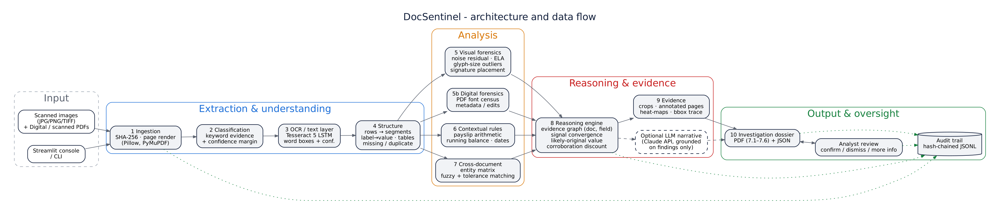

# 🛡️ DocSentinel — AI-Powered Document Forensics & Contextual Intelligence

> **DataOps Innovation Hackathon 2026 (Hack The Core)** · Problem statement: *AI-Powered Document Forensics and Contextual Intelligence System*
> Team: **DocSentinel** · Ayush Kumar (solo)

Traditional document processing stops at OCR: it reads a value, but cannot tell whether the value is **authentic, consistent or reliable**. DocSentinel investigates a *set* of related documents together (identity card, salary slip, loan application, bank statement), finds visual traces of editing, checks the numbers inside each document, correlates entities across documents, and reasons about which signals converge. It then produces an **evidence-backed investigation dossier** where every finding traces back to a page and bounding box in the original file.



---

## ✨ What it does

| Stage | What happens | How |
|---|---|---|
| 1. Submission | Images and PDFs ingested, **SHA-256** hashed, pages rendered | Pillow, PyMuPDF |
| 2. Classification | Identity card / salary slip / loan application / bank statement, with confidence | keyword-evidence scoring |
| 3. OCR & extraction | Word-level text with confidence and boxes; digital PDFs use the exact text layer | Tesseract 5 LSTM |
| 4. Structure | Rows → segments → label/value pairs, transaction tables, missing / duplicate / low-confidence fields, value-column alignment | geometry + RapidFuzz |
| 5. Visual forensics | **Noise-residual consistency** (pasted patches and replaced photos are noise-free), **Error Level Analysis**, **glyph-size outliers**, **signature detection and placement**, signature shape comparison | OpenCV, NumPy |
| 5b. Digital forensics | **PDF font census** (a value in a foreign font), **metadata** (editor software, modified after creation, incremental saves) | PyMuPDF |
| 6. Contextual verification | Payslip arithmetic (components → gross, gross − deductions = net), bank running balance and closing balance, date and age logic | rules |
| 7. Cross-document correlation | Entity matrix for name, DOB, ID number, address, employer and income, each against a reference source | fuzzy + tolerance matching |
| 8. Anomaly investigation | **Reasoning engine**: evidence graph keyed by (document, field); raises *potential manipulation* only when independent visual and data signals converge; estimates the likely original value; **discounts corroboration from a suspicious source** | Python |
| 9. Evidence | Crops of every evidence region, annotated pages, heat-maps, click-to-trace in UI | Pillow |
| 10. Dossier | PDF with sections 7.1–7.6, methodology, limitations and audit trail, plus JSON | ReportLab |
| Oversight | Analyst confirms / dismisses / asks for more info; every action goes to a **hash-chained, tamper-evident audit log** | hashlib |

### Three-level status taxonomy, as the problem statement requires

- 🔵 **Observation**: a visual or technical characteristic (e.g. a region without scanner noise). Not a problem on its own.
- 🟠 **Detected inconsistency**: a verifiable conflict in the data (arithmetic break, cross-document mismatch).
- 🔴 **Potential manipulation (needs verification)**: several *independent* signals converge on one field.

DocSentinel **never** labels anything as confirmed fraud. Consequential decisions stay with a human.

---

## 🎯 Results on the demonstration dataset

Ground truth is in [`samples/case_tampered/MANIFEST.md`](samples/case_tampered/MANIFEST.md).

| # | Manipulation | Detected by | Result |
|---|---|---|---|
| T1 | ID photo replaced after scanning | V1 noise consistency (image region) | ✅ Observation |
| T2 | Payslip Net Pay overwritten 45,200 → 95,200 | V1 noise + V3 glyph size + C3 arithmetic + cross-doc income | ✅ **Potential manipulation**, likely original **45,200** |
| T3 | Application income overwritten → 95,000 | V1 noise + V3 glyph size + cross-doc income | ✅ **Potential manipulation** |
| T4 | Application DOB 1994 vs ID 1996 | Cross-doc DOB | ✅ Inconsistency |
| T5 | Signature outside its box | V4 signature placement | ✅ Observation |
| T6 | Bank closing balance edited in a PDF editor | D1 foreign font + D2 metadata + C5 closing balance | ✅ **Potential manipulation** |
| — | Genuine case (same documents, untouched) | all detectors | ✅ **0 inconsistencies, 0 manipulation flags**, priority LOW |

The reasoning engine also notices that the inflated application income (95,000) *agrees* with the payslip (95,200), but because that payslip value is itself suspect, it does **not** count the agreement as corroboration. The independent bank credit shows 45,200.

`pytest -q` → **12 passed** (each manipulation, genuine-case false positives, audit-tamper detection, safe failure).

---

## 🚀 Setup

### 1. System dependency: Tesseract OCR
| OS | Command |
|---|---|
| Ubuntu / Debian | `sudo apt-get install tesseract-ocr` |
| macOS | `brew install tesseract` |
| Windows | Install from <https://github.com/UB-Mannheim/tesseract/wiki>, then add `C:\Program Files\Tesseract-OCR` to PATH |

### 2. Python packages (Python 3.10+)
```bash
git clone https://github.com/sanjaykumarpathak640-png/docsentinel.git
cd docsentinel
python -m venv .venv && source .venv/bin/activate   # Windows: .venv\Scripts\activate
pip install -r requirements.txt
```

### 3. Run the web console
```bash
streamlit run app.py
```
Open <http://localhost:8501>, choose **Demo case: tampered** and click **Run investigation**.

### 4. Or run from the command line
```bash
python -m docsentinel.cli samples/case_tampered --analyst "Ayush"
python -m docsentinel.cli samples/case_genuine
python -m docsentinel.cli my_docs/*.jpg my_docs/statement.pdf
```
Output goes to `output/<CASE-ID>/`: dossier PDF, `investigation.json`, `audit_log.jsonl`, evidence crops, annotated pages and heat-maps.

### 5. Regenerate the dataset / run tests
```bash
python scripts/generate_samples.py
pytest -q
```

### Optional: LLM narrative
Set `ANTHROPIC_API_KEY` (and optionally `DOCSENTINEL_LLM_MODEL`) to have Claude write a narrative summary. The model receives only the structured findings and is instructed not to add facts. Its output is labelled as AI-generated. Without a key, the deterministic summary is used. Everything else works fully offline.

---

## 🗂️ Repository layout
```
app.py                      Streamlit investigation console
docsentinel/
  ingest.py                 1  submission, hashing, PDF text layer
  extract.py                2/4 classification, schemas, extraction, structure
  ocr.py                    3  Tesseract OCR, row/segment layout grouping
  forensics.py              5  noise, ELA, glyph size, signatures, PDF fonts/metadata
  findings.py               6/7 structural, visual, digital, contextual, cross-document findings
  reasoning.py              8  evidence graph, convergence, likely original, priority, LLM narrative
  evidence.py               9  crops and annotated pages
  dossier.py                10 PDF dossier
  audit.py                  hash-chained audit trail
  pipeline.py, cli.py       orchestration
scripts/generate_samples.py synthetic genuine + tampered dataset
samples/                    demonstration dataset (+ ground-truth MANIFEST)
docs/                       architecture, technical documentation, limitations, screenshots
sample_output/              sample investigation dossier PDFs and JSON
tests/                      pytest suite
```

## 📚 Documentation
- [Technical documentation](docs/TECHNICAL.md): models, methods, pipeline, data model
- [Capabilities, limitations & assumptions](docs/LIMITATIONS.md): implemented / partial / planned / unsupported matrix, false positives
- [Sample dossier (tampered)](sample_output/DEMO-TAMPERED_investigation_dossier.pdf) · [Sample dossier (genuine)](sample_output/DEMO-GENUINE_investigation_dossier.pdf)

## 🔒 Safety, ethics and data
- The whole dataset is **synthetic**: fictional person, employer, IDs and accounts, with every page marked *SYNTHETIC SAMPLE*. No real customer data is used.
- OCR output is never treated as ground truth. Data findings are scaled by OCR confidence, and crops let a reviewer read values directly.
- Processing is local. No document leaves the machine unless the optional LLM narrative is enabled, and even then only finding text is sent, never images.
- Reference frameworks used as guidance only (no compliance claimed): ISO/IEC 27037, 27041, 27042; NIST SP 800-86; OWASP ML Security Top 10.

## 📄 License
MIT for this code. Third-party components keep their own licences: Tesseract (Apache-2.0), OpenCV (Apache-2.0), PyMuPDF (AGPL-3.0, or commercial licence from Artifex), Streamlit (Apache-2.0), ReportLab (BSD), RapidFuzz (MIT). Because PyMuPDF is AGPL, redistribution of a networked service built on this code must follow AGPL terms or use a commercial PyMuPDF licence.
